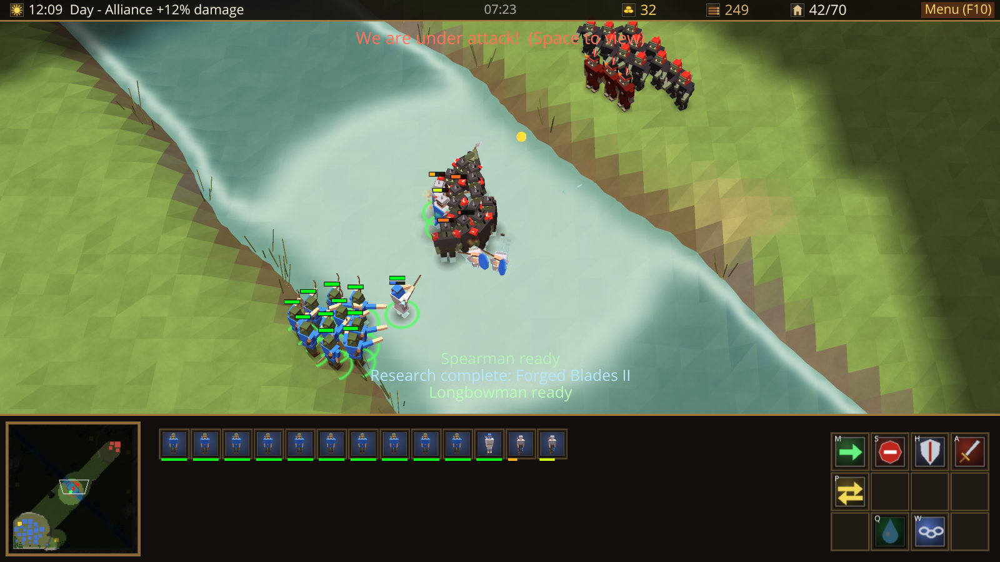
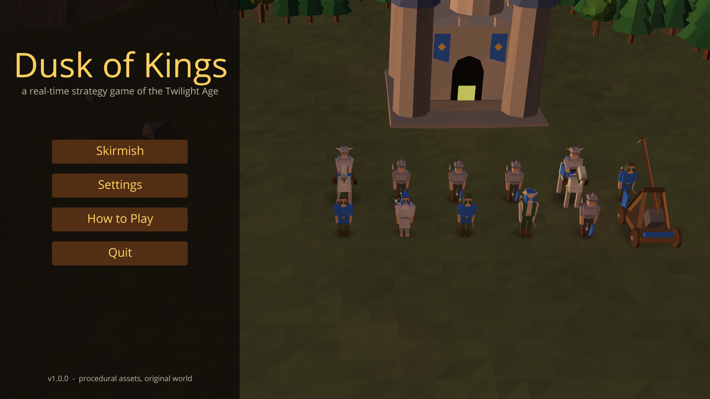
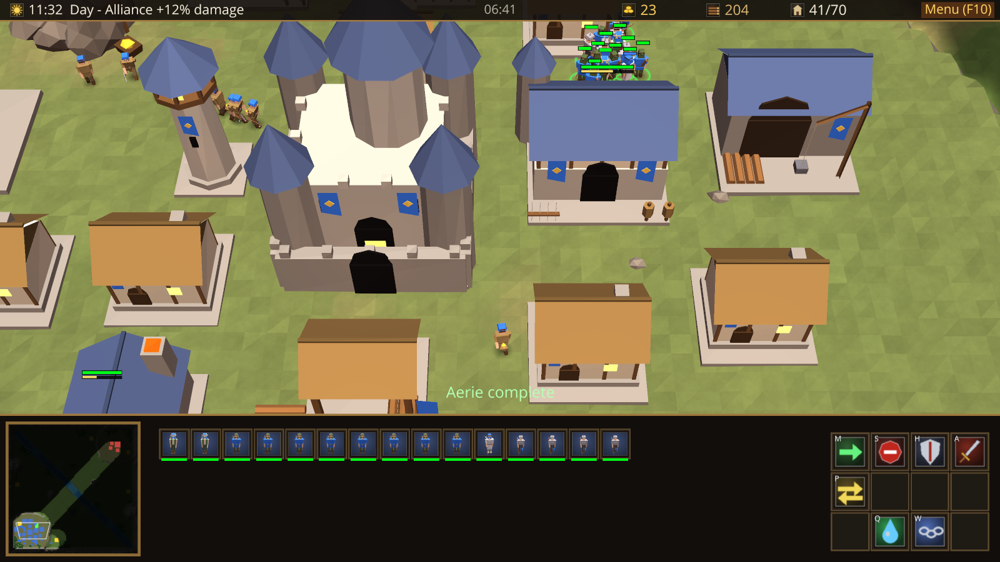
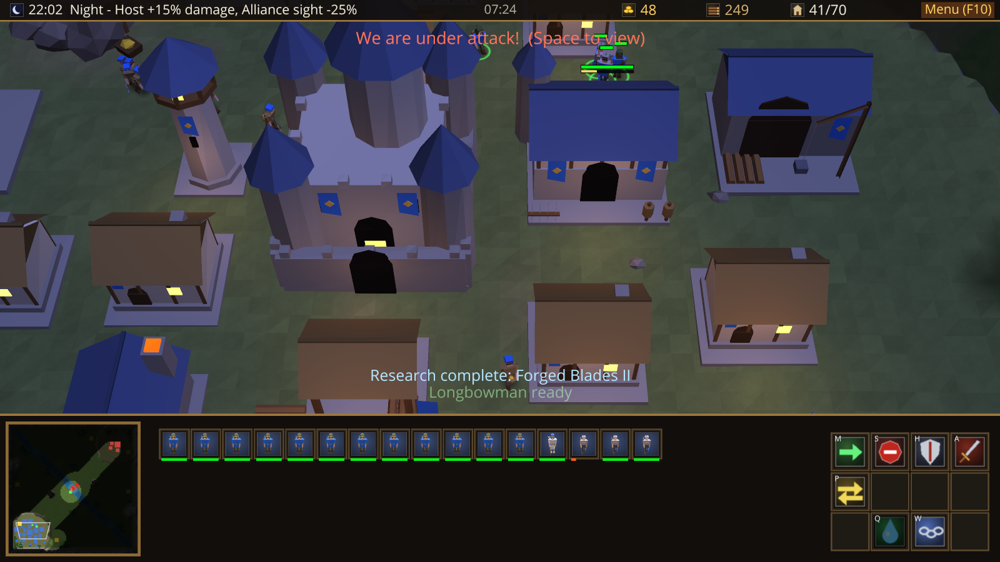
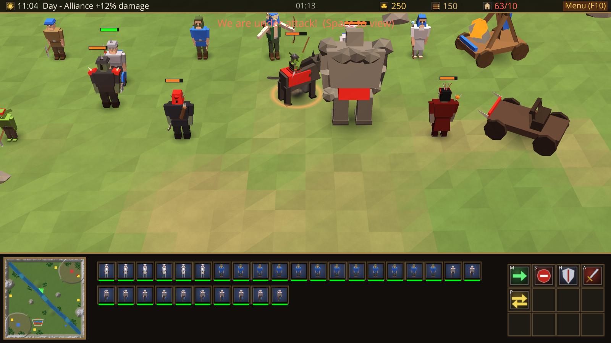

# Dusk of Kings

A real-time strategy game set in an original high-fantasy world, built in Python with [Ursina](https://www.ursinaengine.org/) / Panda3D.
Gather gold and timber, raise a base, research upgrades and send armies against a computer opponent across two hand-designed maps,
while day turns to night and the balance of power shifts with it.

Everything is generated in code: the terrain, every unit, building, tree and icon, the sounds and the music. There are no image, model or audio files.



| | |
|---|---|
|  |  |
|  |  |

## Features

- **Two asymmetric factions**
  - **Valemark Alliance** (humans and forest elves): sturdy, expensive units and strong towers. Peasants stay to construct buildings, which therefore build 25% faster.
  - **Umbral Host** (the Pale Tyrant's legions): cheap, fast units and tier-1 cavalry. Thralls *summon* a building and walk away while it raises itself.
- **16 units, each with its own procedural model and animation:** workers, infantry, archers, cavalry, casters, siege engines and flyers.
- **23 buildings, all distinct models:** two-tier town halls (Keep → Castle, Pit → Stronghold).
- **Economy:** gold mines (at most 5 miners inside at once) and harvestable forests. Trees fall as they are chopped and the pathing opens up. Supply buildings raise the unit cap to 100.
- **Combat depth**
  - Damage and armour types: normal, pierce, siege and magic against light, heavy and fortified.
  - Splash damage, and a minimum range for siege.
  - Weapon, armour and arrow upgrades.
- **Casters:**
  - Loremaster: Heal (autocast) and Slow.
  - Pyre Witch: Fireball and Dark Frenzy.
- **Day and night:** an 8-minute cycle. By day the Alliance deals +12% damage. At night the Host deals +15% and Alliance sight shrinks by 25%.
- **Fog of war** with a high-ground rule: you cannot see up onto plateaus. Explored ground stays dimmed and enemy buildings you have seen are remembered.
- **Computer opponent (Easy / Normal / Hard)**
  - Plays its faction's build order and balances workers between gold and timber.
  - Expands, techs up, scouts, defends and attacks in waves.
  - Obeys the fog of war.
- **Two maps**
  - *Greyfen Crossing:* highland holds split by a river with three fords.
  - *The Shadowed Pass:* a mountain gorge with a central hill fort and narrow side trails.
- **Full RTS controls**
  - Box select, double-click / Ctrl-click to select a type.
  - Control groups, Shift-queued orders, attack-move, patrol, hold position.
  - Rally points, a minimap with fog and camera frame, alerts.
  - Build placement ghosts, and a command card with hotkeys and tooltips.
- **Menus:** skirmish setup, settings, how-to-play, pause and surrender, plus an end-of-match statistics screen.

## Download and play (Windows)

1. Download **[DuskOfKings-v1.0.0-windows-x64.zip](https://github.com/aoancea/dusk-of-kings/releases/latest/download/DuskOfKings-v1.0.0-windows-x64.zip)** from the [latest release](https://github.com/aoancea/dusk-of-kings/releases/latest).
2. Unzip it anywhere.
3. Run `DuskOfKings\DuskOfKings.exe`.

No Python or installation is needed. Windows may show a SmartScreen warning for an unsigned app: choose *More info → Run anyway*.

## Run from source

Requires Python 3.11+.

```bash
python -m venv .venv
.venv\Scripts\activate            # source .venv/bin/activate on Linux / macOS
pip install -r requirements.txt
python main.py
```

Useful command-line options:

| Command | What it does |
|---|---|
| `python main.py --quick alliance host normal` | Skip the menus: your faction, enemy faction, difficulty |
| `python main.py --map shadowed_pass --quick host alliance hard` | Same, on The Shadowed Pass |
| `python main.py --aivsai --speed 4` | Watch two computer players fight, 4x speed |
| `python main.py --nofog --quick` | Play without fog of war |

The first launch writes the generated sounds to `cache/` (about a second); later launches reuse them.

## Controls

| Input | Action |
|---|---|
| Left click / drag | Select a unit / box-select units |
| Double click, Ctrl+click | Select every unit of that type on screen |
| Shift + click | Add to / remove from the selection |
| Right click | Smart order: move, attack, gather (mine or tree), help construct, return cargo, set rally point |
| A, then click | Attack-move (or attack a target) |
| M / S / H / P | Move, stop, hold position, patrol |
| B | Build menu (workers), then the building's hotkey, then click to place (Shift keeps placing) |
| G / R | Gather / return cargo (workers) |
| Q / W | Caster abilities (right-click the button to toggle Heal autocast) |
| Ctrl + 1-9, 1-9 | Create / recall a control group (press twice to centre the camera) |
| Arrow keys, screen edges, middle-mouse drag | Scroll the camera |
| Mouse wheel | Zoom |
| Space / Backspace | Jump to the last alert / to your town hall |
| Alt | Show all health bars |
| Esc / F10 | Cancel, cancel the last queued item, pause menu |

Buildings: select one and click a unit or research button, or use the hotkey shown on the button.

## Factions at a glance

| Role | Valemark Alliance | Umbral Host |
|---|---|---|
| Worker | Peasant | Thrall |
| Infantry | Spearman | Brute |
| Archer | Longbowman | Shade Archer |
| Fast ranged / scout | Forest Warden | Dreadhound Rider (cavalry, tier 1) |
| Heavy | Knight (tier 2) | Stone Ogre (tier 2) |
| Caster | Loremaster: Heal, Slow | Pyre Witch: Fireball, Dark Frenzy |
| Siege | Trebuchet (tier 2) | War Catapult (tier 2) |
| Flyer | Skyhawk Rider (tier 2) | Carrion Drake (tier 2) |
| Defence | Guard Tower | Watch Spire |

All stats, costs, build orders and map layouts live in editable JSON files in [`data/`](data). For example, change `units.json` and restart to rebalance.

## How it is built

| Area | What's inside |
|---|---|
| `core/` | Match simulation, players, RTS camera, data loading, shaders, procedural audio, scripted autotests |
| `world/` | Heightfield terrain from map features (plateaus, ramps, rivers, fords, mountains), pathing grid, A* search, forests, water, fog of war, sky |
| `units/` | Unit logic (orders, steering, combat), procedural rigs, GPU rigid skinning |
| `buildings/` | Construction, production and research queues, towers, procedural building models |
| `economy/` | Gold mines and the worker state machine (mine, chop, return, build) |
| `combat/` | Damage model, vectorised target acquisition, projectiles, batched particles, abilities |
| `ai/` | The computer opponent |
| `ui/` | HUD, minimap, command card, menus, unit portraits rendered offscreen from the real models |

Technical highlights:

- **Rendering**
  - Units are skinned on the GPU: one draw call per unit, bones driven by the procedural animation code.
  - Shadows, selection rings, health bars and particles are batched into one draw call each.
  - A battle of 270 units on screen runs at about 85 fps on the development machine.
- **Pathing**
  - Time-sliced weighted A* with string-pulling, plus shared group paths and formations.
  - Separation steering is vectorised with numpy.
- **Fog of war**
  - Per-team numpy visibility grids.
  - The world and water shaders sample a smoothed fog texture.
- **Testing**
  - Scripted autotests drive the real game, take screenshots and assert behaviour.
  - Coverage: pathing, combat, economy, fog, menus, input, equal-cost battle simulations and full AI-vs-AI matches.

```bash
python main.py --autotest m1        # map, camera, selection, pathing, formations, models
python main.py --autotest m2        # combat, damage types, day/night bonus, siege, flyers, towers, casters
python main.py --autotest m3        # gathering, construction (both factions), training, tech, depletion, supply
python main.py --autotest m6        # fog of war, high ground, remembered buildings
python main.py --autotest m7        # menus, pause, settings, build menu, surrender / victory
python main.py --autotest input     # picking, smart right-click, rally points, control groups, hotkeys
python main.py --autotest balance   # equal-cost army battles, day and night, tier 1 and tier 2
python main.py --autotest aivai     # a full AI-vs-AI match (also aivai2..4)
python main.py --autotest perf      # 130 vs 130 units
```

Screenshots and a log land in `screenshots/autotest/`.

## Build the Windows executable

```bash
pip install pyinstaller
build_exe.bat
```

The game is written to `dist/DuskOfKings/`. Zip that folder to share it.

## Credits

Code, models, textures, sounds and music are procedurally generated by this project. Factions, places and characters are original creations.

Licensed under the [Apache License 2.0](LICENSE).
